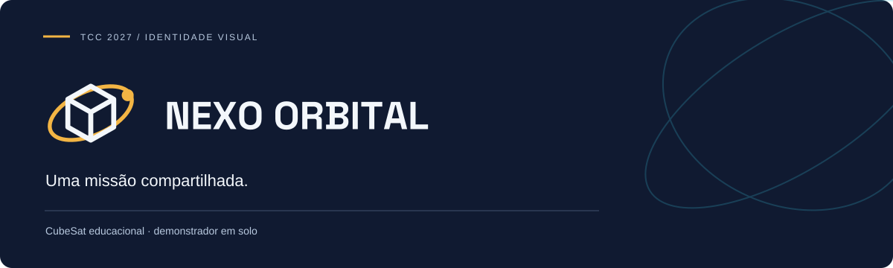
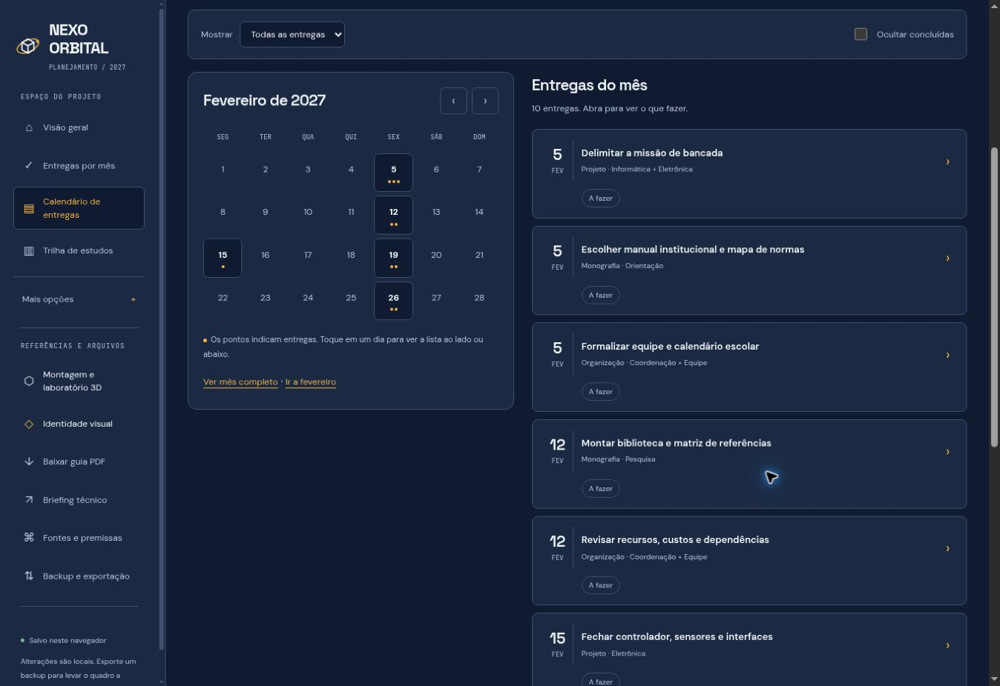
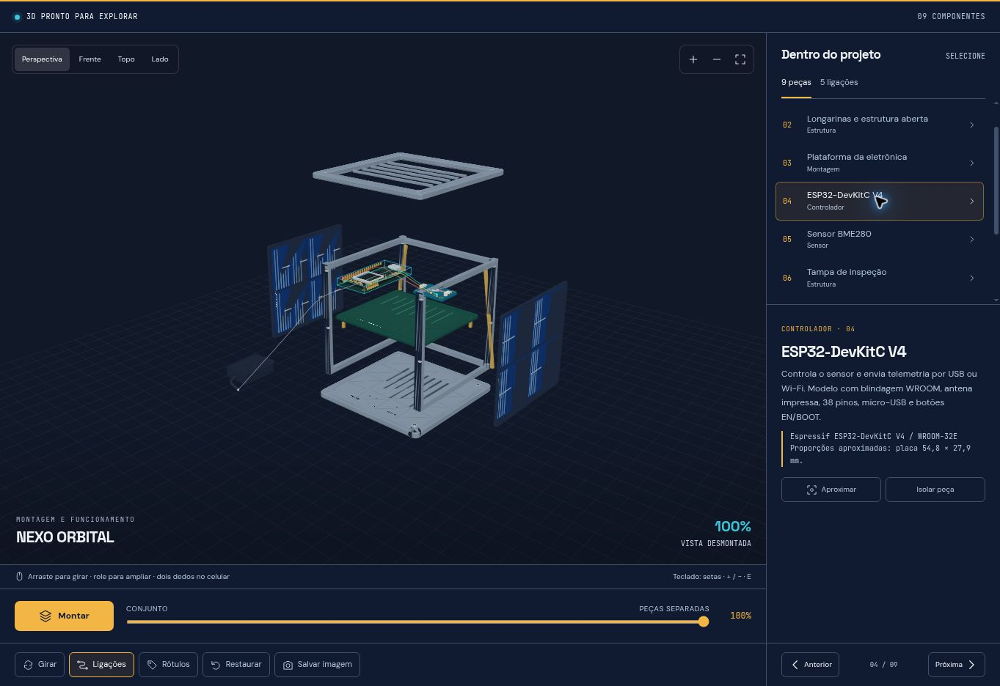

<div align="center">



# NEXO ORBITAL · Cronograma 2027

**Quadro interativo · Trilha de estudos · Monografia ABNT · Artigo INIC**

Início em **1º de fevereiro de 2027** · Entrega principal em **30 de julho de 2027** · Reserva até **30 de setembro de 2027**

[Abrir cronograma ↗](https://perabru.github.io/nexo-orbital-cubesat/) · [Briefing](briefing.html) · [Cronograma completo](docs/cronograma.md) · [Monografia e INIC](docs/monografia-inic.md)

</div>

## Identidade visual 2027

**Uma missão compartilhada.**

O encontro entre um cubo e uma órbita traduz a integração entre estrutura, eletrônica, software e comunicação. A marca assume a precisão de um instrumento de bancada e a curiosidade de uma missão espacial.

**Personalidade:** Preciso · Exploratório · Colaborativo.

[**Explorar o manual visual ↗**](https://perabru.github.io/nexo-orbital-cubesat/identidade-visual/) · [**Baixar guia PDF**](identidade-visual/guia-identidade-visual.pdf) · [**Baixar kit da marca**](identidade-visual/kit-identidade-visual.zip)

O guia reúne conceito, assinaturas, construção, área de proteção, redução mínima, cores, tipografia, fundos, usos incorretos e aplicações. O kit inclui as marcas em SVG, os arquivos de fontes com suas licenças e os dados da identidade.

| Cor | HEX | Aplicação |
| --- | --- | --- |
| Azul missão | `#101A31` | Base institucional, títulos e fundos escuros. |
| Âmbar solar | `#F3B544` | Foco, chamadas e marcos de entrega; texto escuro sobre a cor. |
| Ciano telemetria | `#39C5DD` | Linhas de conexão e diagramas; texto escuro sobre a cor. |
| Branco orbital | `#F3F7FB` | Fundo de documentos e versão negativa da marca. |
| Azul painel | `#1B2942` | Superfícies de interface e blocos de informação. |

**Tipografia:** Space Grotesk nos títulos, DM Sans nos textos e JetBrains Mono nos dados técnicos.

Estrutura editorial inspirada no [Manual de Identidade Visual de São José dos Campos](https://www.sjc.sp.gov.br/media/aqpbdbrj/14448_e_s7_identidade-visual-psjc.pdf). As marcas e aplicações foram desenvolvidas para este projeto.

## Aprender para construir

[**Abrir trilha de estudos ↗**](https://perabru.github.io/nexo-orbital-cubesat/#study)

- 8 etapas entre fevereiro e julho, com prática, critérios e entregas relacionadas.
- 19 fontes de estudo e 8 arquivos autorais para download.
- Hardware, BOM, matriz de referências e protocolo de experimento.
- Progresso local com backup próprio, busca e impressão da trilha.

[Guia completo](docs/trilha-de-estudos.md) · [Baixar kit](materiais/kit-estudos-cubesat.zip) · [Revisão das datas](docs/revisao-fevereiro.md)

O Drive de Pobre foi solicitado e a tentativa de consulta ficou registrada: o catálogo exigiu verificação humana. Nenhum arquivo desse acervo foi validado ou redistribuído. A curadoria usa fontes primárias e exercícios próprios.

## O planejamento virou a página inicial

O `index.html` é um quadro interativo inspirado no fluxo Kanban. O briefing técnico anterior permanece em [`briefing.html`](briefing.html), com a identidade visual 2027 aplicada e a documentação preservada.

| Frente | Entrega planejada |
| --- | --- |
| Produto / engenharia | Construção, integração, validação e versão final até julho |
| Monografia | Fundamentação, método, resultados, discussão, revisão e depósito |
| Artigo INIC | Escrita desde junho; texto integral em junho e pacote pronto em julho |
| Gestão | Recursos, responsáveis, revisões e apresentação |
| Reserva | Correções e adaptação em agosto e setembro |

As datas do INIC 2027 são **metas internas de prontidão**, sem inventar prazo oficial de submissão. Consultar a [página do evento](https://www.univap.br/inic/) e o [modelo vigente](https://www.univap.br/inic/submissao_trabalhos.php).

## Interações disponíveis

- 58 registros, sendo 2 históricos arquivados; 56 cartões ativos com responsável, início, prazo, prioridade, dependências e critérios de conclusão.
- Colunas por frente ou por estado; arrastar e reordenar no computador.
- Edição pelo teclado e pelo celular; filtros por mês, responsável, estado e texto.
- Linha do tempo, calendário de entregas e áreas próprias para monografia e artigo.
- Checklist, notas, link de evidência, arquivamento reversível e desfazer.
- Backup JSON, exportação CSV, calendário ICS e impressão completa.

## Abra e continue

Baixe o repositório e abra `index.html`. HTML, CSS, JavaScript, fontes e símbolo da marca estão incorporados. Nenhuma instalação é necessária para usar o quadro.

```bash
git clone https://github.com/perabru/nexo-orbital-cubesat.git
cd nexo-orbital-cubesat
```

> **Dados locais:** as alterações ficam neste navegador. Não há sincronização automática entre pessoas ou dispositivos. Exporte JSON e importe no mesmo projeto para compartilhar o andamento. Os dados do usuário não são enviados ao GitHub.

[Manual de uso e backup →](docs/uso-do-quadro.md)

## Monografia com revisão ABNT

A escrita acompanha a pesquisa. Os cartões cobrem estrutura, método, resultados, revisão e apresentação, com apoio nas NBR 14724:2024, 10520:2023, 6023:2025, 6028:2021, 6024:2012 e 6027:2012. O projeto de pesquisa também considera a NBR 15287:2025 quando aplicável.

O manual institucional e a orientação definem a aplicação final. Este quadro organiza a revisão; não emite certificação automática de conformidade.

[Etapas de escrita, normas e fontes →](docs/monografia-inic.md)

## Arquivos principais

| Arquivo | Função |
| --- | --- |
| [`index.html`](index.html) | Cronograma e quadro interativo |
| [`briefing.html`](briefing.html) | Briefing técnico anterior |
| [`plano-inicial.json`](plano-inicial.json) | Cópia do planejamento original |
| [`docs/cronograma.md`](docs/cronograma.md) | Inventário das entregas |
| [`docs/monografia-inic.md`](docs/monografia-inic.md) | Escrita acadêmica e fontes |
| [`docs/uso-do-quadro.md`](docs/uso-do-quadro.md) | Manual e backup |
| [`README_BRIEFING.md`](README_BRIEFING.md) | Apresentação anterior do projeto |

Os demais documentos de arquitetura, telas e tecnologias permanecem em `docs/`.

## Verificação

```bash
node tests/cronograma.test.cjs
```

Os testes verificam datas, dependências, importação, conclusão, exportações e limites do plano.

---

Projeto de [Bruno Michel Pera](https://github.com/perabru) · [Créditos e licenças](THIRD_PARTY_NOTICES.md)


## Laboratório 3D e construção

[**Abrir montagem interativa e passo a passo**](https://perabru.github.io/nexo-orbital-cubesat/laboratorio-3d/)

Explore dispositivos em 3D com rotação, zoom, seleção de peças, vista desmontada e conexões que acompanham os componentes. O guia reúne etapas de construção, materiais, ligações, ferramentas, critérios de teste e referências técnicas. A apresentação segue a identidade visual do projeto.

[Conteúdo e modelos](laboratorio-3d/) · [Guia de manutenção](laboratorio-3d/README.md)


## Cronograma simplificado

A página inicial reúne **Visão geral**, **Entregas por mês** e **Calendário**. Comece pelas próximas ações, abra uma entrega para conferir seu checklist e acompanhe as datas na agenda mensal. O quadro detalhado, as edições e as exportações ficam em **Mais opções**.

O planejamento vai de fevereiro a julho de 2027, com reserva em agosto e setembro e escrita do artigo INIC a partir de junho. Datas e confirmações oficiais do evento devem ser verificadas quando divulgadas.


### Prévia do cronograma


### Prévia do calendário



### Prévia do laboratório 3D


