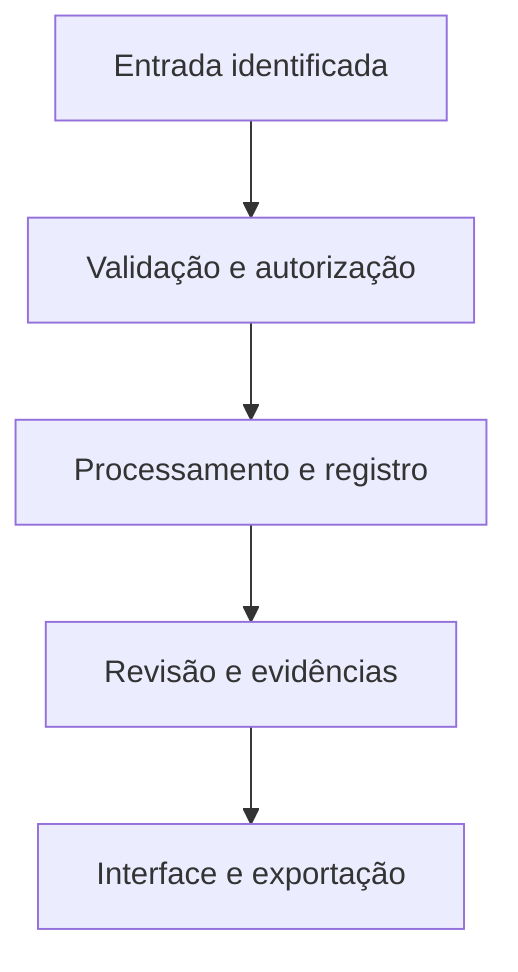

# Arquitetura proposta

## Montar

Esquema, energia, sensor e versão da estrutura.

## Adquirir

Firmware identifica dispositivo e sequência.

## Receber

Gateway valida e registra o pacote.

## Explorar

Painel, histórico e modelo explicativo.

## Apresentar

Custo, proposta de empresa e campanha.

## Dados do domínio

- **Mission / Device** — Identidade, versão, objetivo e configuração da bancada.
- **TelemetrySession / Packet** — seq, received_at, device_time, unidades, flags e perdas.
- **Subsystem / Part / CADVersion** — IDs entre modelo glTF, BOM, arquivos técnicos e função.
- **TestRun / Evidence** — Procedimento, montagem, firmware, resultado e arquivo.
- **CostItem / OfferVersion** — Origem do custo, esforço, margem e pacote ofertado.
- **Campaign / Claim** — Público, peça, chamada e evidência de cada afirmação.

## Contas e permissões

Sessão no servidor, autorização por papel e propriedade, arquivos privados por escopo e auditoria de mudanças. A interface nunca é a única barreira de acesso.
